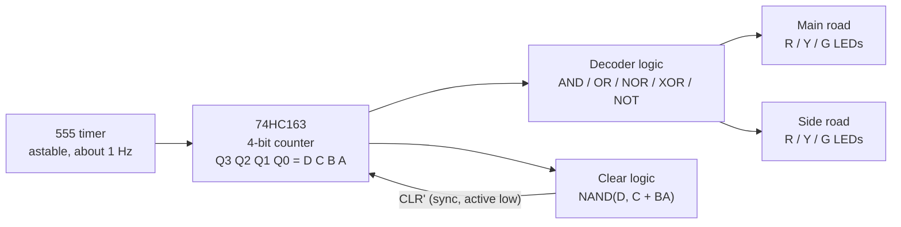

# Traffic Light Controller using a MOD-12 Counter
**Digital Electronics – Basic Electronics course project (TieEdu)**
**Name:** _<your name>_  **Roll / ID:** _<your id>_

## 1. Aim
Design a traffic-light controller for a two-road junction (Main road and Side road) using a **MOD-N counter** and combinational logic gates. A slow clock drives a MOD-12 counter; the counter output is decoded into the Red / Yellow / Green lamps of both roads.

## 2. Block diagram


## 3. MOD-N counter theory
A MOD-N counter counts through N distinct states (0 to N-1) and then returns to 0.
* Number of flip-flops: n = ceil(log2 N). For N = 12, n = 4 (a 4-bit binary counter has 16 states, so 12 to 15 are unused).
* To truncate the count, detect state **N-1** and force the next state to 0. The 74HC163 has a **synchronous, active-low clear**, so the clear gate must detect **11 (1011)**.
* Detecting 1011 needs D, B and A. For safety the clear logic also catches 12-15 (any state with D = 1 and C = 1), so the counter recovers from an illegal state in one clock:

  `CLR' = NOT( D . (C + B.A) )`   (AND, OR, NAND: three gates)

Result: count sequence 0, 1, 2, ..., 11, 0, 1, ... (MOD-12).

## 4. Timing plan (1 clock = 1 second)
| Count | D C B A | Main road | Side road | Clocks |
|:-:|:-:|:-:|:-:|:-:|
| 0 - 4  | 0000 - 0100 | **Green**  | Red | 5 |
| 5 - 6  | 0101 - 0110 | **Yellow** | Red | 2 |
| 7 - 9  | 0111 - 1001 | Red | **Green**  | 3 |
| 10 - 11| 1010 - 1011 | Red | **Yellow** | 2 |

Total cycle = 12 s. (Change N and the decoding to get other timings.)

## 5. Truth table (D = Q3 ... A = Q0)
| Count | DCBA | MG | MY | MR | SG | SY | SR |
|:-:|:-:|:-:|:-:|:-:|:-:|:-:|:-:|
| 0 | 0000 | 1 | 0 | 0 | 0 | 0 | 1 |
| 1 | 0001 | 1 | 0 | 0 | 0 | 0 | 1 |
| 2 | 0010 | 1 | 0 | 0 | 0 | 0 | 1 |
| 3 | 0011 | 1 | 0 | 0 | 0 | 0 | 1 |
| 4 | 0100 | 1 | 0 | 0 | 0 | 0 | 1 |
| 5 | 0101 | 0 | 1 | 0 | 0 | 0 | 1 |
| 6 | 0110 | 0 | 1 | 0 | 0 | 0 | 1 |
| 7 | 0111 | 0 | 0 | 1 | 1 | 0 | 0 |
| 8 | 1000 | 0 | 0 | 1 | 1 | 0 | 0 |
| 9 | 1001 | 0 | 0 | 1 | 1 | 0 | 0 |
| 10 | 1010 | 0 | 0 | 1 | 0 | 1 | 0 |
| 11 | 1011 | 0 | 0 | 1 | 0 | 1 | 0 |
| 12-15 | 11xx etc. | X | X | X | X | X | X |

MG/MY/MR = Main Green/Yellow/Red; SG/SY/SR = Side Green/Yellow/Red. States 12-15 never occur in normal operation, so they are **don't cares**.

## 6. K-map simplification
Rows are D C, columns are B A (Gray code). X = don't care.

**Main Green (MG) — 1 for counts 0-4**

| DC \ BA | 00 | 01 | 11 | 10 |
|:-:|:-:|:-:|:-:|:-:|
| **00** | 1 | 1 | 1 | 1 |
| **01** | 1 | 0 | 0 | 0 |
| **11** | X | X | X | X |
| **10** | 0 | 0 | 0 | 0 |

**Main Yellow (MY) — 1 for counts 5, 6**

| DC \ BA | 00 | 01 | 11 | 10 |
|:-:|:-:|:-:|:-:|:-:|
| **00** | 0 | 0 | 0 | 0 |
| **01** | 0 | 1 | 0 | 1 |
| **11** | X | X | X | X |
| **10** | 0 | 0 | 0 | 0 |

**Side Green (SG) — 1 for counts 7, 8, 9**

| DC \ BA | 00 | 01 | 11 | 10 |
|:-:|:-:|:-:|:-:|:-:|
| **00** | 0 | 0 | 0 | 0 |
| **01** | 0 | 0 | 1 | 0 |
| **11** | X | X | X | X |
| **10** | 1 | 1 | 0 | 0 |

**Side Yellow (SY) — 1 for counts 10, 11**

| DC \ BA | 00 | 01 | 11 | 10 |
|:-:|:-:|:-:|:-:|:-:|
| **00** | 0 | 0 | 0 | 0 |
| **01** | 0 | 0 | 0 | 0 |
| **11** | X | X | X | X |
| **10** | 0 | 0 | 1 | 1 |

### Simplified Boolean equations
| Output | Equation | Source |
|---|---|---|
| MG | `MG = D'C' + C B' A'` | K-map |
| MY | `MY = C (A xor B)` | K-map (cells 5 and 6 with don't cares 13, 14) |
| SG | `SG = D B' + C B A` | K-map |
| SY | `SY = D B` | K-map |
| MR | `MR = SG + SY = D + C B A` | Main is red whenever Side has right of way (counts 7-11) |
| SR | `SR = MG + MY = (D + C B A)'` | Side is red whenever Main has right of way (counts 0-6) |

Check: MR and SR are complements of each other, so each road always has exactly one lamp lit.

## 7. Gate-level implementation
Use 74HC-series ICs (5 V). `BA` and `CBA` are shared.

| Signal | Gates | IC |
|---|---|---|
| BA | AND(B, A) | 74HC08 |
| CLR' | NAND(D, OR(C, BA)) | 74HC32 + 74HC00 |
| nDC | NOR(D, C) | 74HC02 |
| nBA | NOR(B, A) | 74HC02 |
| **MG** | OR(nDC, AND(C, nBA)) | 74HC08 + 74HC32 |
| xAB | XOR(A, B) | 74HC86 |
| **MY** | AND(C, xAB) | 74HC08 |
| CBA | AND(C, BA) | 74HC08 |
| **MR** | OR(D, CBA) | 74HC32 |
| **SR** | NOR(D, CBA) | 74HC02 |
| nB | NOT(B) | 74HC04 |
| **SG** | OR(AND(D, nB), CBA) | 74HC08 + 74HC32 |
| **SY** | AND(D, B) | 74HC08 (second chip) |

### Components
| Qty | Part | Qty | Part |
|:-:|---|:-:|---|
| 1 | 74HC163 (4-bit sync counter) | 6 | LEDs: 2 red, 2 yellow, 2 green |
| 1 | 74HC00 (NAND) | 6 | 680 ohm resistors (LED series) |
| 1 | 74HC02 (NOR) | 1 | NE555 timer |
| 1 | 74HC04 (NOT) | 1 | R1 = 10 k, R2 = 68 k |
| 2 | 74HC08 (AND) | 1 | C = 10 uF (timing), 10 nF (555 pin 5) |
| 1 | 74HC32 (OR) | 1 | 5 V supply, breadboard, wires |
| 1 | 74HC86 (XOR) | | |

### 74HC163 connections
| Pin | Name | Connect to |
|:-:|---|---|
| 1 | CLR' | output of the clear NAND |
| 2 | CLK | 555 output (pin 3) |
| 3-6 | A, B, C, D (data) | GND (unused) |
| 7 | ENP | +5 V |
| 9 | LOAD' | +5 V (load disabled) |
| 10 | ENT | +5 V |
| 14 / 13 / 12 / 11 | QA / QB / QC / QD | A (LSB) / B / C / D (MSB) of the logic |
| 8 / 16 | GND / VCC | 0 V / +5 V |

### 555 clock
Astable: `f = 1.44 / ((R1 + 2 R2) C)` = 1.44 / ((10 k + 136 k) x 10 uF) is about **0.99 Hz**.
Pins: 1 GND, 2 and 6 joined, 4 and 8 to +5 V, 5 to 10 nF to GND, 7 between R1 and R2, 3 is the clock output.

### LEDs
Gate output -> 680 ohm -> LED -> GND. Six outputs: MG, MY, MR, SG, SY, SR.

## 8. Verification
`verify/verify_design.py` models the exact gates above and checks:
* the sequence is 0 to 11 and wraps (MOD-12);
* states 12-15 return to 0 on the next clock;
* exactly one lamp is lit per road in every state;
* both roads never have green/yellow at the same time;
* the durations are 5 / 2 / 3 / 2 clocks.

```
python3 verify/verify_design.py
```
Expected last line: `RESULT: ALL CHECKS PASSED`

## 9. Simulation / building
Build in **Logisim Evolution**, **Tinkercad Circuits**, **Proteus** or **Multisim** using section 7. For a quick test use a manual push-button clock (debounced) or a 1 Hz clock source. If your simulator has no 74163, use any 4-bit synchronous counter with a synchronous clear (or build it from four JK flip-flops).

## 10. Results
_Add screenshots here: the circuit (`images/circuit.png`) and the LED states at counts 0, 5, 7 and 10._

## 11. Conclusion
A MOD-12 counter plus simple combinational logic gives a safe, fixed-time traffic-light controller. Changing N (and the decoder) changes the timing plan.

## Repository layout
```
README.md
verify/verify_design.py
images/              (add your screenshots)
```
